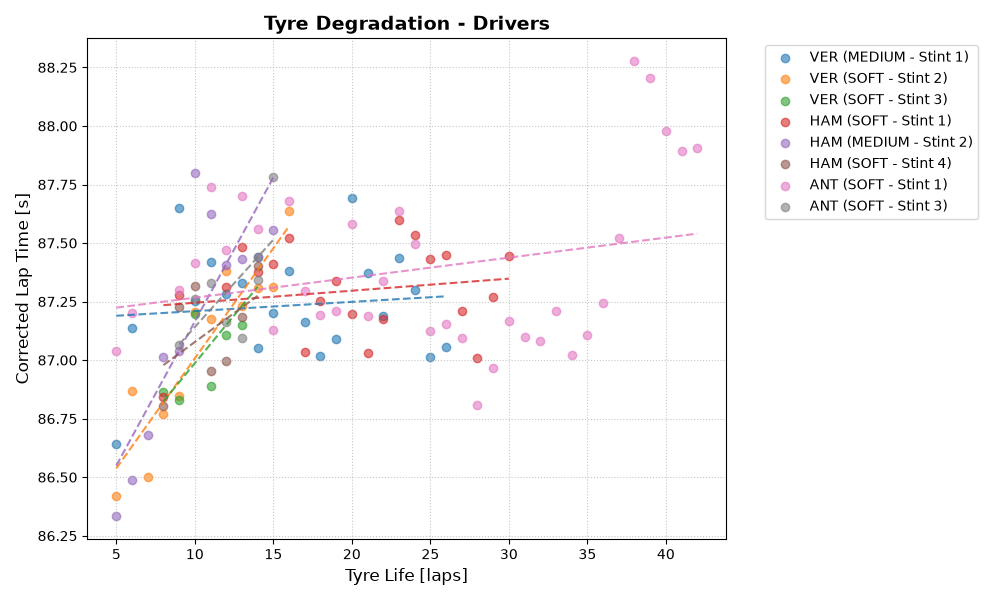
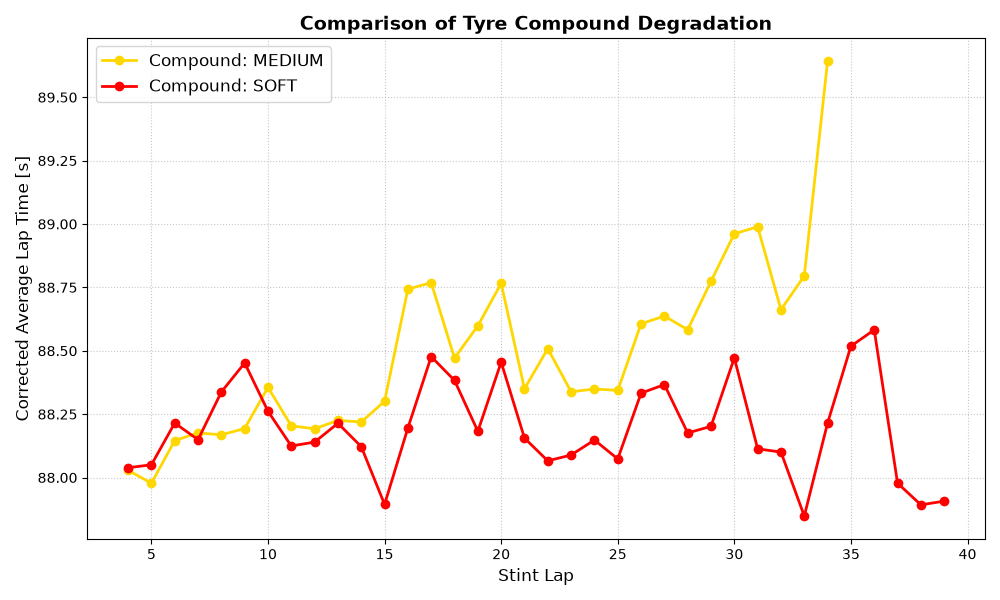

# F1 Tyre Degradation Analysis 🏎️📊

An advanced Python tool built with **FastF1**, **Pandas**, **NumPy**, and **Matplotlib** to analyze tyre degradation during Formula 1 Grand Prix races. The project estimates tyre degradation rates by correcting lap times for fuel mass and track evolution, filtering noisy data, and applying linear regression to individual tyre stints.

## Features

- **Fuel Mass Correction:** Adjusts lap times for fuel weight using a fuel mass sensitivity coefficient of `0.032 s/kg` and estimated fuel consumption under different track status conditions.
- **Track Evolution Normalization:** Normalizes lap times relative to the median pace across drivers on each lap to account for changes in track conditions and track evolution.
- **Data Cleaning & Filtering:**
  - Removes laps associated with pit entry and pit exit.
  - Filters Safety Car, Virtual Safety Car, and other neutralized periods using `TrackStatus` values `4`, `5`, `6`, and `7`.
  - Excludes the opening lap.
  - Focuses on dry slick compounds: **SOFT**, **MEDIUM**, and **HARD**.
  - Excludes early stint laps (`StintLap <= 3`) to focus on established tyre performance.
- **Anomaly Detection:** Identifies and removes unusually slow laps using neighboring lap time differentials (`DiffPrev` and `DiffNext`) with a relative threshold of 1.5% of the stint median lap time.
- **Tyre Degradation Estimation:** Uses linear regression (`numpy.polyfit`) on corrected lap times against tyre age (`TyreLife`) to estimate degradation rates in seconds per lap.
- **Physical Constraints & Stint Validation:** Rejects negative degradation slopes and stints with insufficient data or tyre age variation.
- **Driver & Compound Visualization:** Generates plots showing individual driver stint trends and average corrected lap times by tyre compound.

## Example Analysis

The following visualizations were generated from the **2026 season, Grand Prix round 19**, using race-session data loaded through FastF1.

### Driver tyre degradation

Each point represents a lap from a driver's stint. Dashed lines show linear regression trends against tyre age (`TyreLife`). The plotted drivers and stints are identified in the legend.



### Tyre compound comparison

This plot compares average corrected lap times by stint lap for the compounds present in the selected race data. It shows the observed pace profile; it is not, by itself, a per-compound regression slope or a controlled comparison of tyre wear.



## Prerequisites

Make sure Python 3.9+ is installed along with the required libraries:

```bash
pip install fastf1 pandas numpy matplotlib
```

## Usage

Run the script and follow the prompts to select the season and Grand Prix:

```bash
python main.py
```

You will be prompted to enter:
- Your email and password (if required by your FastF1 setup).
- The season year.
- The Grand Prix name (e.g., `Monza`) or round number.

The script retrieves race-session data, processes lap times, calculates degradation rates, prints the results, and displays the visualizations.

## Methodology

For each driver and tyre stint, the tool:

1. Retrieves race-session lap data from FastF1.
2. Estimates fuel usage and corrects lap times for fuel mass.
3. Normalizes lap times against the median pace for each lap to account for track evolution.
4. Filters out pit laps, neutralized laps, non-slick compounds, opening laps, and early stint laps.
5. Detects unusually slow laps using neighboring lap time differentials.
6. Fits a linear regression to corrected lap times against tyre age (`TyreLife`).
7. Discards negative slopes and stints with insufficient data or tyre-age variation.

The resulting degradation rate is expressed in **seconds per tyre lap (s/lap)**.

## Output

- A printed table of degradation rates by **Driver**, **Stint**, and **Compound**.
- A driver stint plot showing corrected lap times and linear trend lines against tyre age.
- A compound comparison plot showing average corrected lap times by stint lap for the compounds present in the data.

## Limitations

- Degradation is estimated using linear regression and may not capture nonlinear tyre wear.
- Lap time corrections rely on estimated fuel consumption and a fixed fuel sensitivity coefficient.
- Track evolution normalization uses the median lap time across drivers and may be affected by traffic, strategy, or changing conditions.
- Traffic effects, driver pace variation, tyre management, temperature, and setup differences may still influence the estimated degradation.
- The compound comparison chart displays average corrected lap times by stint lap; differences between compounds should not be interpreted as pure tyre degradation without controlling for driver, stint length, track conditions, and tyre age.
- Results represent an approximation of tyre degradation rather than a direct measurement of physical tyre wear.

## Disclaimer

This project is intended for educational, analytical, and motorsport data exploration purposes. Degradation estimates should not be interpreted as official Formula 1 tyre performance data.
